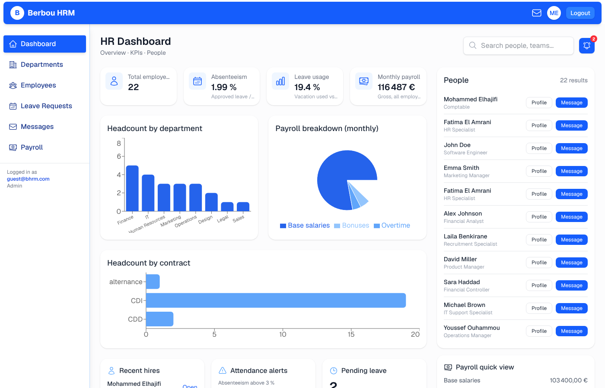
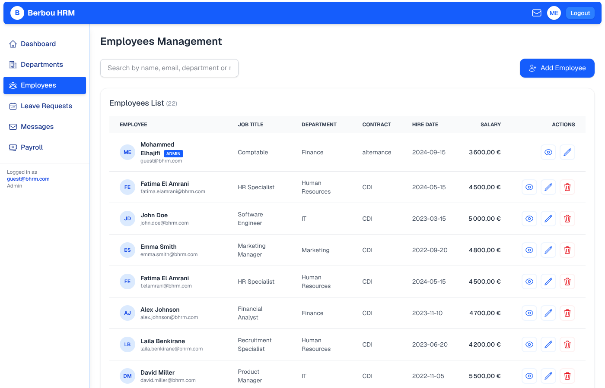
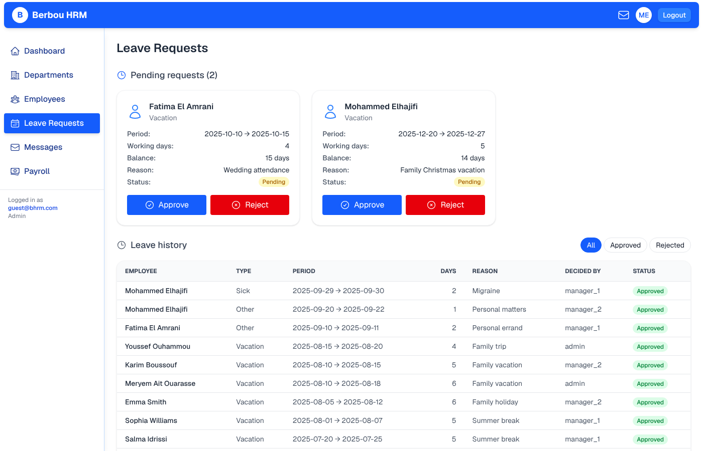
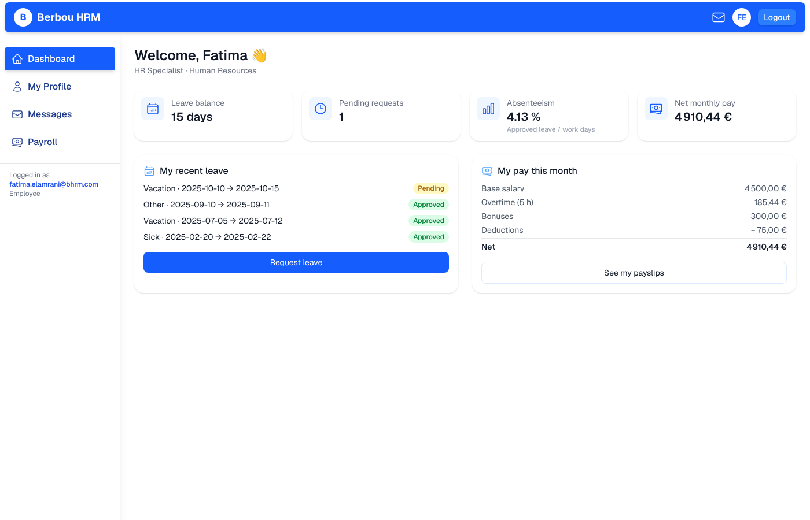
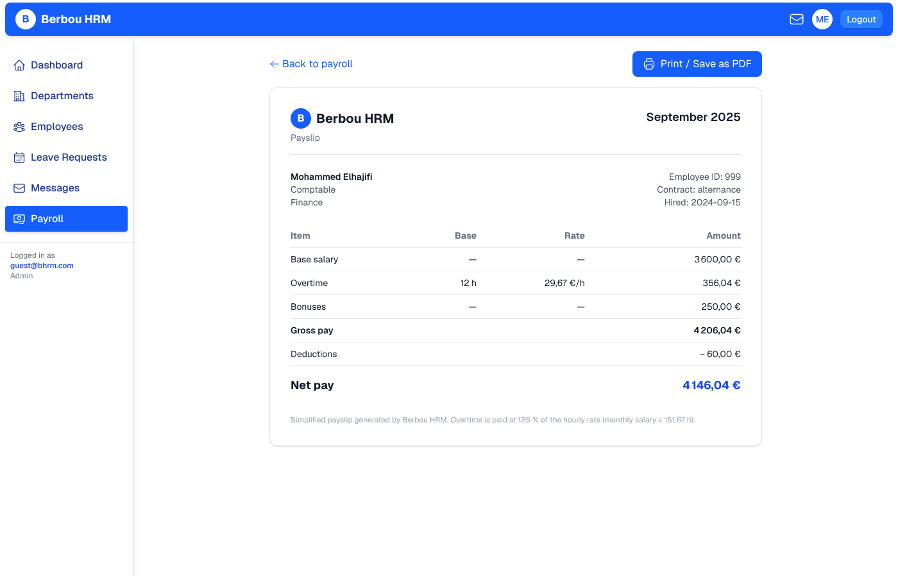

<div align="center">


# Berbou HRM

**Understand. Empower. Grow.**

An all-in-one Human Resource Management platform: employees, departments, leave, payroll and internal messaging in a single web app.

[](https://bhrm.vercel.app)


[Live demo](https://bhrm.vercel.app) · [Features](#features) · [Getting started](#getting-started) · [Deployment](#deployment)

<br />



</div>

---

## Overview

Berbou HRM gives HR teams a clear view of their workforce and gives employees self-service access to their own information. It offers two experiences:

- **Administrators** manage the whole company: headcount, contracts, leave approvals, payroll runs and company-wide announcements.
- **Employees** see their own profile, leave balance and payslips, request time off and message colleagues.

## Features

### 📊 Dashboard
- Company KPIs: headcount, absenteeism rate, leave usage and monthly payroll cost
- Charts by department and by contract type
- Attendance alerts for employees above an absenteeism threshold
- Pending leave counter and people search
- A personal dashboard for employees: leave balance, pending requests and net pay

### 👥 Employees & departments
- Full employee records: profile, contract, job, department, projects, payroll and documents
- Create, edit and delete employees, with validation and unique emails
- Department view with headcount and monthly payroll per team

### 🗓️ Leave management
- Employees request vacation, sick or other leave from their profile
- Leave is counted in **working days** (Mon–Fri), and requests are checked against the balance and existing leave
- Admins approve or reject; approved vacation is deducted from the balance automatically
- Full history with filters and the name of the approver

### 💶 Payroll
- Gross and net pay per employee, including overtime and bonuses
- **Run payroll**: generates the month's payslips for everyone in one click (safe to re-run)
- Printable payslips (*Print → Save as PDF*)
- CSV export that opens directly in Excel

### ✉️ Internal messaging
- Inbox, Sent, Archived and Trash folders, with unread badges
- Reply, archive, delete and restore
- Admin announcements to the whole company

### 🔐 Security
- Passwords hashed with **scrypt**
- **httpOnly, HMAC-signed** session cookies that can't be read or forged in the browser
- Role checks on every API route; employees only ever receive their own data
- Read-only demo account: edit controls hidden in the UI and changes blocked on the server
- Passwords are never sent to the browser

## Screenshots

| Employee directory | Leave requests |
| :---: | :---: |
|  |  |
| **Employee dashboard** | **Payslip** |
|  |  |

## Tech stack

| Layer | Technology |
| --- | --- |
| Framework | [Next.js 15](https://nextjs.org) (App Router, Route Handlers, Middleware) |
| UI | React 19, Tailwind CSS 4, Heroicons, Recharts |
| Storage | [Upstash Redis](https://upstash.com) in production, local JSON files in development |
| Auth | Custom: scrypt password hashing and HMAC-signed session cookies (Node `crypto`) |
| Hosting | [Vercel](https://vercel.com) |

## Getting started

### Prerequisites

- Node.js 20 or later
- npm

### Installation

```bash
git clone https://github.com/elhajifi/bhrm.git
cd bhrm
npm install
cp .env.example .env.local
```

In `.env.local`, set `SESSION_SECRET` to a long random string:

```bash
node -e "console.log(require('crypto').randomBytes(32).toString('hex'))"
```

### Run

```bash
npm run dev      # development server on http://localhost:3000
npm run build    # production build
npm start        # run the production build
npm run lint     # lint the code
```

### Demo accounts (seed data)

| Role | Email | Password |
| --- | --- | --- |
| Administrator (view only) | `guest@bhrm.com` | `guest` |
| Employee | `fatima.elamrani@bhrm.com` | `password123` |
| Employee | `john.doe@bhrm.com` | `password123` |

All other seeded employees use `password123`.

The `guest` account is **read-only**: it can open every admin page, but the buttons to add, edit, delete, approve, send messages or run payroll are hidden, and the API refuses any change from it (HTTP 403). This keeps the public demo clean. To change which accounts are read-only, set `DEMO_READ_ONLY_EMAILS`.

> [!WARNING]
> These accounts come from the demo data in `data.json`. Change these passwords before using the app with real people.

## Configuration

| Variable | Required | Description |
| --- | --- | --- |
| `SESSION_SECRET` | **Yes** (in production) | Secret used to sign session cookies. Use a long random string. |
| `KV_REST_API_URL` / `KV_REST_API_TOKEN` | For Vercel | Upstash Redis credentials. When set, data is stored in Redis. |
| `UPSTASH_REDIS_REST_URL` / `UPSTASH_REDIS_REST_TOKEN` | Alternative | Same as above, using Upstash's own variable names. |
| `DEMO_READ_ONLY_EMAILS` | No | Comma-separated emails of view-only accounts. Defaults to `guest@bhrm.com`. Set it to an empty value to disable. |
| `DATA_DIR` | No | Folder containing `data.json` and `messages.json` when using file storage. Defaults to the project root. |

## Deployment

The app is deployed on Vercel and redeploys automatically on every push to `main`.

Because Vercel's file system is read-only, the production deployment stores its data in Redis:

1. Import the repository on [vercel.com/new](https://vercel.com/new) (Next.js preset, default settings).
2. Add **Storage → Upstash for Redis** (the free plan is enough) and connect it to the project with the prefix `KV`.
3. Add `SESSION_SECRET` under **Settings → Environment Variables**.
4. Deploy. On the first request, the database is seeded from `data.json` and `messages.json`.

Without Redis credentials (for example in local development), the app reads and writes the JSON files instead.

## Project structure

```
bhrm/
├── app/
│   ├── page.js                    # Login
│   ├── auth/                      # Authenticated area (header + sidebar layout)
│   │   ├── dashboard/             # Admin and employee dashboards
│   │   ├── departments/
│   │   ├── employees/             # Directory + [id] profile
│   │   ├── leave/                 # Approvals and history
│   │   ├── messages/
│   │   └── payroll/               # Overview + payslip/[employeeId]/[payslipId]
│   └── api/
│       ├── auth/login · logout    # Session management
│       ├── me                     # Current user
│       ├── data                   # Employees CRUD (role-aware)
│       ├── directory              # Public colleague list (names only)
│       ├── leave                  # Request, approve, reject, cancel
│       ├── messages               # Send, list, archive, delete, restore
│       └── payroll/run            # Monthly payslip generation
├── components/                    # Shared UI and user context
├── lib/
│   ├── auth.js                    # Hashing, signed sessions, access control
│   ├── db.js                      # Storage layer (Redis or JSON files)
│   └── hr.js                      # Business rules: working days, pay, currency
├── middleware.js                  # Redirects logged-out visitors to login
├── scripts/hash-passwords.mjs     # Migrates plain-text passwords to hashes
├── data.json                      # Seed data: employees
└── messages.json                  # Seed data: messages
```

## Business rules

All HR calculations live in [`lib/hr.js`](lib/hr.js), so the dashboard, payroll, payslips and API always agree.

| Rule | Definition |
| --- | --- |
| Gross pay | Base salary + overtime + bonuses |
| Net pay | Gross pay − deductions |
| Overtime | Hours × (monthly salary ÷ 151.67 h) × 125 % |
| Leave duration | Working days (Monday to Friday), inclusive |
| Absenteeism | Approved leave days ÷ yearly work days |
| Currency | EUR, configurable through `CURRENCY` in `lib/hr.js` |

## Roadmap

- [ ] File uploads for contracts and ID documents
- [ ] Password reset by email
- [ ] Public holidays in the working-day calculation
- [ ] Relational database (PostgreSQL) for larger organisations
- [ ] French interface

## Author

**Mohammed El Hajifi**: [@elhajifi](https://github.com/elhajifi)
